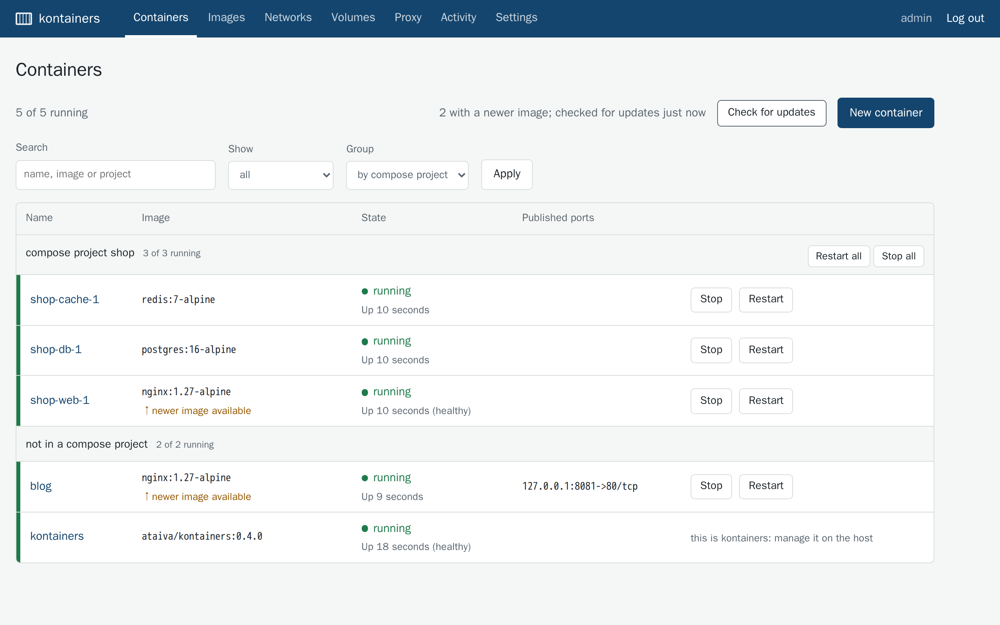
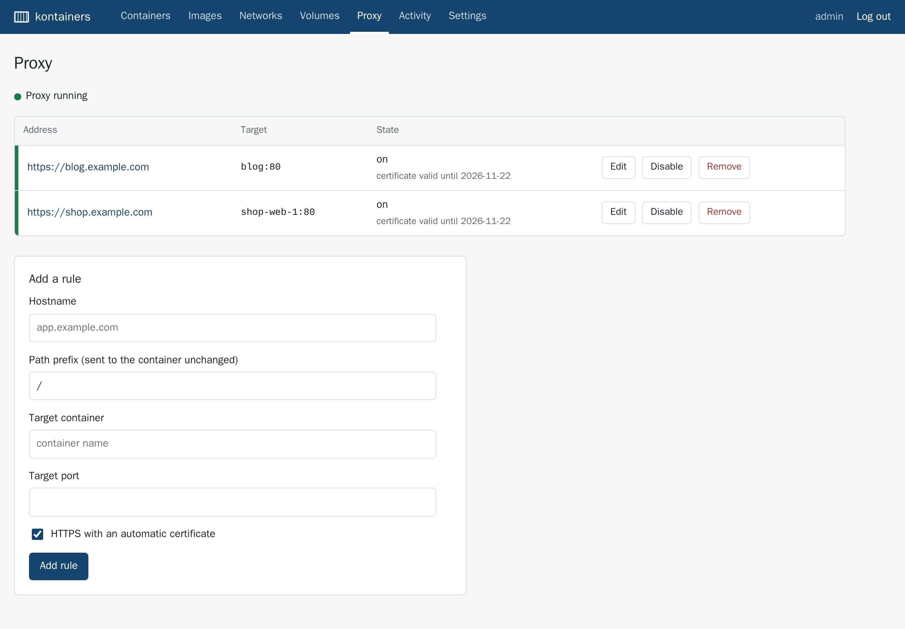

# kontainers

Manage the containers on one Docker host from a browser, and point a domain at any of them with an
HTTPS certificate it gets and renews for you. One container does both.

## Why it exists

If you run Portainer for your containers and Nginx Proxy Manager for your domains, kontainers is
one container that does the everyday part of both:

- Add a rule like `shop.example.com` to container `shop-web-1`, port 80, and the site is up over
  HTTPS. The Proxy page shows which certificates are valid and until when, and which rules point at
  a container that is stopped or gone.
- `docker compose up` recreates containers with new IDs. kontainers notices within 10 seconds and
  reconnects them, so the routes keep working.
- Every 6 hours kontainers checks which containers have a newer image for their tag. Opt a
  container in and it is updated on its own: the new container is watched while it settles,
  and if it stops, restarts or turns unhealthy, the old one is put back and that image is held
  back. (Watchtower, which did this, was archived in December 2025.)
- Notifications to a webhook or an ntfy topic when a container crashes, runs out of memory,
  turns unhealthy, has a newer image, is updated, or a certificate is about to expire.
- Update image recreates a container from the newest image of its tag with its settings, volumes
  and networks: compose and `docker run` containers too. Edit settings changes the ones made in
  kontainers. If the new container does not stay up, the old one is put back.

It is also careful about the host, because access to Docker is root on it. It listens on
127.0.0.1, has no default password, never force-removes a container you made (only a
replacement it is rolling back), and will not stop or remove itself. The Security section below lists every default.

## What it costs to run

Memory and start time were measured on the 0.4.0 release candidate, on an EC2 m7g.4xlarge (arm64,
16 vCPUs, Ubuntu 24.04, Docker 29.9.3), by `scripts/test.sh screenshots` in three runs. The download
size is the published 0.4.1 image's, and those of 0.5.0 to 0.13.0 are the same to 0.1 MB: 19 MB more than 0.3.0's, because the Bun base image grew by
16 MB (oven/bun 1.4.4-slim against 1.3.1-slim) and Caddy and Debian by 4 MB. 0.4.0 also stored
the Caddy binary twice (16.5 MB more), which 0.4.1 fixed.

| | |
|---|---|
| Download | 101.9 MB (arm64) and 102.3 MB (amd64) for 0.4.1 to 0.10.0, 102.0 and 102.4 MB for 0.11.0 to 0.13.0, compressed layers on Docker Hub |
| Memory at idle | 30 to 34 MiB, with Caddy serving two HTTPS rules and four other containers on the host (`docker stats` after 30 s, three runs) |
| Start | 239 to 299 ms from `docker start` to a healthy `/healthz` (fifteen starts over three runs) |

`scripts/test.sh screenshots` repeats these measurements and regenerates the screenshots. On a
Mac under OrbStack the 0.2.1 build used 53 to 55 MiB and started in 1.0 to 4.2 s.

## Try it

    curl -O https://raw.githubusercontent.com/ao/kontainers/main/compose.yaml
    docker compose up -d
    docker compose logs kontainers | grep 'setup token'

Open http://127.0.0.1:8080, paste the token, and create your account. On a server, reach it over
SSH with `ssh -L 8080:127.0.0.1:8080 your-server`. To route domains, see
[Proxy rules and certificates](#proxy-rules-and-certificates).

## Status

Version 0.2 was a rewrite; 0.3 added update checks; 0.4 adds automatic updates, notifications,
editing, clean up and an activity log. Releases 0.1.x accepted any login and must not be used.

What works, and is covered by the test suites below:

- containers: list, inspect, create, start, stop, restart, unpause, remove (stopped containers
  only; kontainers never force-removes them), logs (filter, 300 to 5000 lines, timestamps on or
  off, download). Commands are split with shell quoting (`sh -c "echo hi; sleep 60"`, and
  `$'one\ntwo'` for a line break in an argument) but no shell runs and nothing is expanded. The
  list has a search, a state filter including "needs attention", grouping by compose project, and
  a tick box per container to start, restart, stop or remove up to 200 at once, one at a time,
  each on the Activity page (remove takes only the stopped ones; kontainers' own containers and
  ones being updated have no box; after 20 s the page comes back and the rest goes on). The
  detail page has the container's history: created, started, stopped (with the exit code),
  killed (with the signal), out of memory, health changes, renamed, removed, from Docker's
  events, under its name across updates and under its own ID when renamed, kept for 30 days
  (`KONTAINERS_HISTORY_DAYS`), at most 2000 entries a name (checked hourly) and 300 000 in all.
  Docker itself keeps only its last few hundred events; at start kontainers reads those since
  the last one it recorded, up to a day back, and the history says when some may be missing.
  The Events page has every container's history, with a search and a filter for problems only
  (crashes, out of memory, unhealthy). The Containers page says how many times each container
  crashed in the last 24 hours, counted for that container (one that replaced it starts at 0);
  three or more count as needing attention, and so does a stopped container whose last exit was
  a crash. A crash is an exit code other than 0 that nobody
  asked for: no docker stop, restart or kill (other than a reload signal such as HUP) since it
  last started. Counts come from the history, so a container past 2000 entries shows fewer. The detail page shows the command, ports,
  restarts, health and limits, and CPU, memory, network and process counts refreshed every 5
  seconds. A container created in kontainers can get labels (`KEY=value`; names kontainers and
  Docker set themselves are refused, except `kontainers.autoupdate` in small letters; a label the
  image carries does not count as the container's own for these), limits (memory such as
  `512m`, CPUs such as `1.5`, a process count), and be made on a user network with aliases there,
  for other containers on it to reach it by. Duplicate opens the Create form filled in from one
  made in kontainers (image, command, environment, labels, restart policy, network, limits), but
  not its ports, volumes or network aliases, which the new one needs its own of; Pull and Start
  are not ticked. A network kontainers no longer offers is named on the form, not copied, and so is
  a tag that has moved to another image since. It needs the image the container was made from, and
  its tag, to be on the host. Compose file shows (and downloads) a `compose.yaml` with the same
  settings and the networks the container is on now (aliases, fixed addresses), its volumes and
  networks declared `external`, for moving it into compose: remove it in kontainers and run
  `docker compose up -d` with the file. Values are quoted, with `$` doubled so compose does not
  expand it. The page says when a volume is anonymous (a prune can delete it while no container
  uses it) or the tag has moved to another image; a container disconnected from every network,
  on the default bridge and other networks, or with links, gets no file. The file names its own
  compose project (the container's name, with a short hash when capitals or dots had to change),
  and is refused when a project of that name already exists. Both are for administrators only,
  as they show environment values.
- update image: pull the image again and, if it changed, recreate the container under the same
  name, on the same networks with the same aliases, with the same volumes (anonymous ones
  included). One created in kontainers gets the settings it was created with. Any other
  (compose, `docker run`) is copied whole from `docker inspect`, privileges and limits included,
  except values equal to the old image's (environment entries, command, working directory,
  healthcheck fields, labels), which the new image supplies. The copy is created and compared with
  the old container while the old one still runs; only if nothing is missing is the old one
  stopped (with its own stop timeout, compose's `stop_grace_period`) and set aside. It is put back
  if the new one cannot be started or stops within 5 seconds.
  A value equal to the old image's may have been set on purpose (`user: "1000"` in a compose file
  when the image says the same). kontainers cannot tell, so when the new image changes the user
  it runs as, or an environment value that is a path into one of its volumes (`PGDATA`), the
  update is refused; other such values (a working directory, `JAVA_HOME`) take the new image's,
  and the update says which. Not handled: `--rm` containers, digest-pinned and image-ID references,
  swarm tasks, images built on the host, containers whose network, process or IPC namespace
  another container shares (`network_mode: service:...`) or whose volumes another mounts by ID,
  and kontainers itself, its socket proxy and the services its own `depends_on` named when it was
  created (other services in its compose project are updated like any). A copy mounts the old container's anonymous volumes by
  name, so `docker compose down -v` leaves them; Clean up lists them as unused anonymous volumes.
- edit settings, for containers created in kontainers (compose ones change in the compose file): change the image, command, ports,
  environment, volumes, labels, restart policy or limits (networks stay); saving recreates the container the same way, with the
  old one put back if the new one does not stay up. Bad input is refused before anything stops.
- update checks: every 6 hours, and on "Check for updates", kontainers asks the registry which
  image each container's tag points at now (through the Docker daemon, which downloads only the
  manifest) and marks containers that run an older one, including containers left on an old image
  after a `docker pull`. Tags are checked, not digest-pinned references. Under docker-socket-proxy
  this needs `DISTRIBUTION=1`, which `compose.yaml` sets. On Docker Hub, checks count toward the
  pull rate limit: from one address without a login, six checks of six images lowered the
  remaining count by three (Docker 29.9, 2026-11-14); Docker Hub reported a limit of 100 an hour.
- newer version tags: after each update check, kontainers lists the tags of each repository
  whose containers use a version tag (`nginx:1.27`, `postgres:17`, `v2.3-alpine`) and says when a
  newer one of the same shape is tagged, within the major version and above it (`1.29`, and `2.1`
  as a new major version); pre-releases and other variants (`-rc1`, another suffix) do not count.
  It lists them itself, with the registry's API and the login saved on the Settings page, and sends
  a notification per reference when newer ones appear (again after 60 days while they stay). It
  never changes a tag: for a container made in kontainers the page links to Edit settings with the
  new tag filled in (only that tag; a link cannot fill in another image); others change in their
  compose file. The notifications are their own event on the Settings page, off for existing
  targets. A lookup that fails says why on the container's page. Answers are capped (4 MB a page,
  50 000 tags, 90 s a repository), no redirects are followed, a registry's token service must be
  HTTPS, and link-local addresses and the Docker API are never asked. Registries on the host's
  loopback address cannot be reached from kontainers' container (its loopback is its own).
  `KONTAINERS_VERSION_CHECK=0` turns this off.
- automatic updates, per container (any that Update image handles; opted in on its page or with
  the label `kontainers.autoupdate=true`): after each check that
  finds a newer image, the container is updated as Update image does it, then watched for
  `KONTAINERS_AUTOUPDATE_SETTLE` seconds (30), and with a healthcheck until it reports healthy
  (up to `KONTAINERS_AUTOUPDATE_HEALTH_TIMEOUT`, 120). If it stops, restarts or turns unhealthy,
  the old container is put back and that image is held back; a newer image is tried. A container
  replaced under the same name outside kontainers is not updated automatically, unless it has the
  label.
- notifications to webhooks (a JSON POST) and ntfy topics, for: a newer image (once per image),
  an automatic update and its result, a container that stopped on its own (a crash, an error
  exit, out of memory; not a stop someone asked for, and not exit code 0), a container that turned
  unhealthy and recovered, and an HTTPS rule with no certificate after 15 minutes or one that
  is close to expiry. Settings has a test button and shows the last result per target.
- registry logins for private images (Docker Hub, GHCR, your own registry), used for pulls and
  update checks; passwords stored encrypted
- images: list, pull, remove, per tag; which containers use each one, and a filter for the unused
- networks and volumes: list, create, remove
- clean up: untagged images, unused tagged images, unused networks and unused anonymous
  volumes, listed with sizes first; anything a container uses, running or stopped, stays, and
  named volumes are never removed in bulk
- proxy rules: hostname and path prefix to a container port, HTTPS with a certificate obtained
  automatically, or plain HTTP; edit, enable, disable, remove; kept across restarts
- local accounts, administrators or read-only, first-run setup, database backups
- Update all, per compose project on the Containers page: the members with a newer image are
  updated one at a time, as Update image does it
- an Activity page: every action and failed attempt, by whom and from where, kept for a year

Not included: exec/terminal, compose stacks, multiple hosts, and roles finer than administrator
and read-only.

## Security

Access to the Docker API is root on the host. Anyone who can log in to kontainers as an
administrator can start a privileged container that mounts the host's filesystem, so treat every
administrator account as root.

Accounts are administrators or read-only. A read-only account sees the containers, images,
networks, volumes and proxy rules, container logs, the container history and Events page
(including removed containers'), and on the Activity page what was done to them (not by whom or
from where); it changes nothing but its own password and two-factor login,
and sends at most 30 forms a minute. The server refuses every other change and the database
downloads, and the pages leave those controls out. It does not see the other accounts, logins,
notification targets, registry logins, backups, or the logs of kontainers itself and its socket
proxy. Environment values are hidden on the container pages for everyone, but commands,
healthcheck output and logs are not: a read-only account reads whatever the containers print or
were started with. An administrator changes a role on the Settings page (the account's sessions
end), and so does `docker compose exec kontainers bun src/main.ts set-role USERNAME admin|viewer`
on the host; one administrator always stays.

What kontainers does about it:

- It listens on `127.0.0.1` by default. Outside a container it refuses to start on any other
  address over plain HTTP unless `KONTAINERS_PUBLIC_URL` is an `https://` URL or
  `KONTAINERS_ALLOW_INSECURE=1` is set. The image listens on all interfaces inside the container,
  so publish its port as `127.0.0.1:8080:8080`.
- There is no default password. On first start it prints a one-time setup token to its log; the
  first account is created with that token, and setup then closes.
- Sessions are server-side, in an `HttpOnly`, `SameSite=Strict` cookie (`Secure` and `__Host-`
  prefixed behind HTTPS), and expire after 12 hours idle or 7 days. Logging out, or changing a
  password, ends them. Passwords are hashed with argon2id.
- Two-factor login, per account (Settings): after the password, a six-digit code from an
  authenticator app (TOTP, RFC 6238), or one of ten one-time recovery codes. Each code works once,
  and wrong codes count toward the login limit below; 20 within 24 hours also lock the account's
  code step for 24 hours, until another account turns its two-factor off or kontainers restarts. Another account can turn it off for a user,
  and so can `docker compose exec kontainers bun src/main.ts reset-2fa USERNAME` on the host
  (`docker exec <container> ...` without compose). The keys are
  in the database, so the backup holds them: keep it as private as the data volume.
- Every state change is a POST that needs a per-session CSRF token and a same-origin `Origin` /
  `Sec-Fetch-Site`. Requests with an unknown `Host` are refused, to stop DNS rebinding.
- Login is limited, per 15 minutes, to 5 failures per username and 20 per client address (the
  higher address limit is because everyone behind one SSH tunnel or proxy shares an address).
  Setup is limited to 5 wrong tokens per address.
  `X-Forwarded-For` is only read from addresses listed in `KONTAINERS_TRUSTED_PROXIES`.
- Container creation only sends image, name, command, environment, labels, port bindings, named
  volumes, restart policy, limits (memory, CPUs, processes) and a network with aliases to Docker. Host
  paths as volumes are refused unless `KONTAINERS_ALLOW_BIND_MOUNTS=1`. Ports without a host
  address are published on `127.0.0.1`. The network must be a bridge network that kontainers
  itself, its Docker API container and the proxy are not on (a container on the API network could
  reach Docker), and an alias may not take a name already on it. There is no way to set
  privileged mode, capabilities, devices or host namespaces from the UI.
- The proxy configuration is generated from validated hostnames, path prefixes, container names
  and ports. Caddy's admin API is a unix socket in the data directory, not a TCP port.
- With the proxy on, kontainers' container shares a network with the proxy targets so Caddy
  can reach them; the UI refuses connections from that network, so a compromised target cannot
  reach the login page. Containers no enabled rule points at are taken off it. A rule cannot
  point at kontainers itself or at the container serving its Docker API.
- kontainers itself and the container serving its Docker API (the socket proxy) get no Stop,
  Restart, Remove, Update or Edit, so the UI cannot cut itself off.
- Every action, including failed ones and logins, is in the Activity log, with who and from where.
- Notification URLs and tokens are stored in the database as given (only scheme and host are
  shown); a backup holds them too.

Use `compose.yaml`, which gives kontainers the Docker API through
[docker-socket-proxy](https://github.com/Tecnativa/docker-socket-proxy) rather than the socket
itself. The proxy refuses build, swarm, plugin, secret and system endpoints, and refuses starting an
exec. It does not inspect request bodies, so it narrows what a compromised kontainers can reach
but does not stop it from creating a privileged container.

To reach kontainers from another machine, use an SSH tunnel:

    ssh -L 8080:127.0.0.1:8080 your-docker-host

or put it behind a reverse proxy that terminates HTTPS, and set `KONTAINERS_PUBLIC_URL`.

## Running

With compose (recommended):

    curl -O https://raw.githubusercontent.com/ao/kontainers/main/compose.yaml
    docker compose up -d
    docker compose logs kontainers | grep 'setup token'

Then open http://127.0.0.1:8080, enter the token, and create the first account.

With `docker run`, mounting the socket directly:

    docker run -d --name kontainers --restart unless-stopped --stop-timeout 30 \
      -p 127.0.0.1:8080:8080 \
      -v /var/run/docker.sock:/var/run/docker.sock \
      --group-add "$(stat -c %g /var/run/docker.sock)" \
      -v kontainers-data:/data \
      ataiva/kontainers:0.13.1
    docker logs kontainers | grep 'setup token'

The image runs as an unprivileged user, so it needs the socket's group (`--group-add`). On
Docker Desktop the socket is owned by root; use the compose file there.

## Updates and notifications

kontainers checks every 6 hours (`KONTAINERS_UPDATE_CHECK_HOURS`), and when you press Check for
updates, which image each container's tag points at on its registry. It asks the Docker daemon,
which fetches only the manifest. Containers on an older image are
marked on the list and on their page. A digest the registry never served counts as a local build,
not as an older image.

Any container that Update image handles can be updated automatically: tick "Update
automatically" on its page (or when creating it in kontainers), or give it the label
`kontainers.autoupdate=true`. The label suits compose, where it survives `docker compose up`
recreating the container:

    services:
      app:
        image: ghcr.io/me/app:1
        labels:
          kontainers.autoupdate: "true"

After a check finds a newer image, the container is
recreated from it with the same settings, volumes and networks, and watched for
`KONTAINERS_AUTOUPDATE_SETTLE` seconds (30); with a healthcheck, until it is healthy (up to
`KONTAINERS_AUTOUPDATE_HEALTH_TIMEOUT`, 120 s). If it stops, restarts or turns unhealthy, the old
container is put back and that image is held back until a newer one appears. A stop someone
asks for while it settles (`docker stop`, a backup script) is not a failure: the new container is
left as they left it. If kontainers itself is stopped meanwhile, it puts the old container back
before it exits; `compose.yaml` gives it 30 s for that (`stop_grace_period`), and with `docker run`
add `--stop-timeout 30`. If it is killed first, it finishes the job when it starts again: what it
was replacing, and whether that was running, is written down before anything is stopped.

A compose container keeps its compose labels, and compose's record of its image
(`com.docker.compose.image`) is set to the new image, so a later `docker compose up -d` leaves it
running instead of recreating it (tested with Docker Compose from `docker:29-cli`, on Docker 28 and on
Docker 29 with its containerd image store). Its settings
still change only in the compose file. kontainers itself, the container serving its Docker API
and the services kontainers depends on (its `depends_on`, as it was when kontainers was created)
are never updated by it, whatever their labels say.

When automatic updates run is set on the Settings page: an update window (hours in UTC, which may
cross midnight, and days of the week), and a delay, the hours a newer image waits after a check
first sees it (so a release that is pulled or fixed in its first hours is not installed). A
container that waits says until when on its page, and Check for updates counts it.

Notification targets are set on the Settings page, with a Send test button:

- a webhook gets a JSON POST:

      {"event": "exit", "title": "web stopped", "message": "web (nginx:1.27) stopped with exit code 1.",
       "container": "web", "at": "2026-11-16T12:00:00.000Z", "text": "...", "content": "..."}

  `text` and `content` repeat the title and message, for receivers that read one of those fields
  (Slack-style and Discord-style incoming webhooks; not tested against those services).
- an ntfy topic URL (`https://ntfy.sh/your-topic`, or your own server) gets the message as plain
  text with `Title` and `Tags` headers.

A token, if given, is sent as `Authorization: Bearer`. The events: a newer image (once per image,
naming the containers that use it),
an automatic update and its result, a container that stopped on its own (a crash, an error exit or
out of memory; not a stop someone asked for, and not exit code 0; once per 10 minutes per
container), a container that turned unhealthy and healthy again, and an HTTPS rule with no
certificate 15 minutes after it was added or with one close to expiry (once a day): a sixth of its
lifetime left, at most 14 days, which for a 90-day certificate means renewal has been failing
for two weeks.

## Proxy rules and certificates

Turn the proxy on with `KONTAINERS_PROXY=1` and publish ports 80 and 443. These two ports are meant
to be public: they serve the sites you route, not the kontainers UI.

    docker run -d --name kontainers --restart unless-stopped --stop-timeout 30 \
      -p 127.0.0.1:8080:8080 -p 80:80 -p 443:443 \
      -e KONTAINERS_PROXY=1 -e KONTAINERS_ACME_EMAIL=REPLACE-WITH-YOUR-EMAIL \
      -v /var/run/docker.sock:/var/run/docker.sock \
      --group-add "$(stat -c %g /var/run/docker.sock)" \
      -v kontainers-data:/data \
      ataiva/kontainers:0.13.1

Use your own email address: Let's Encrypt rejects reserved domains such as example.com, and
kontainers refuses to start with one.

Point the domain's DNS at the host, then add a rule on the Proxy page: hostname, optional path
prefix, target container name and port. kontainers connects the target container to the
`kontainers-proxy` network and Caddy reaches it by name; the target does not need to publish a
port. Every 10 seconds kontainers reconnects targets that left the network, which is what
`docker compose up` does when it recreates a container. The path prefix is matched but not
removed: a rule for `/api` sends `/api/users` to the container as `/api/users`. A wildcard
hostname (`*.example.com`) works over plain HTTP only: Let's Encrypt issues wildcard certificates
over a DNS challenge, which kontainers does not do, so add one HTTPS rule per name instead.

The Proxy page shows, for each rule, whether its target container exists and is running and,
for HTTPS rules, when its certificate expires or that there is none yet. A missing certificate
usually means DNS does not point at this host or ports 80 and 443 are not reachable; the
kontainers log has Caddy's error. With HTTPS on, Caddy obtains a certificate from Let's Encrypt over HTTP-01 or TLS-ALPN-01,
redirects HTTP to HTTPS, and renews the certificate before it expires: Caddy follows the renewal
window the CA suggests, or renews when a third of the lifetime is left. Certificates are stored in
the data volume. Adding the first HTTPS rule to a running kontainers restarts Caddy, which is
briefly unavailable; Caddy did not renew certificates in a process that started without HTTPS rules.

## Configuration

| Variable | Default | Meaning |
|---|---|---|
| `KONTAINERS_LISTEN` | `127.0.0.1:8080` (`0.0.0.0:8080` in the image) | Address for the UI |
| `KONTAINERS_PUBLIC_URL` | unset | Public `https://` URL when behind a TLS reverse proxy; enables `Secure` cookies and HSTS, and is the accepted `Host` |
| `KONTAINERS_TRUSTED_PROXIES` | unset | Comma-separated proxy addresses whose `X-Forwarded-For` is used for rate limiting |
| `KONTAINERS_ALLOW_INSECURE` | `0` | Allow a non-loopback listen address over plain HTTP |
| `KONTAINERS_DATA` | `./data` (`/data` in the image) | Database and certificates |
| `DOCKER_HOST` | `unix:///var/run/docker.sock` | `unix://`, `tcp://` or `http://` address of the Docker API |
| `KONTAINERS_ALLOW_BIND_MOUNTS` | `0` | Allow host paths as container volumes |
| `KONTAINERS_PROXY` | `0` | Run the proxy (Caddy) |
| `KONTAINERS_PROXY_NETWORK` | `kontainers-proxy` | Docker network shared by the proxy and its targets |
| `KONTAINERS_ACME_EMAIL` | unset | Contact address for the ACME account |
| `KONTAINERS_ACME_CA` | Let's Encrypt | ACME directory URL |
| `KONTAINERS_ACME_CA_ROOT` | unset | PEM file to trust for the ACME directory (for a private CA) |
| `KONTAINERS_ACME_RENEW_CHECK` | unset (Caddy's default) | Seconds between Caddy's checks for certificates due for renewal, 1 to 86400; HTTPS rules only |
| `KONTAINERS_SELF_CONTAINER` | the container's hostname | ID or name of kontainers' own container, if `--hostname` changed it; kontainers and the container serving its Docker API get no Stop, Remove or Update |
| `KONTAINERS_UPDATE_CHECK_HOURS` | `6` | Hours between update checks, 0 to 720; `0` turns scheduled checks off ("Check for updates" still works, and automatic updates then follow only its results) |
| `KONTAINERS_AUTOUPDATE_SETTLE` | `30` | Seconds a new container is watched after an automatic update, 0 to 600 |
| `KONTAINERS_AUTOUPDATE_HEALTH_TIMEOUT` | `120` | Seconds to wait for "healthy" after settling, for images with a healthcheck, 0 to 3600 |
| `KONTAINERS_AUTOUPDATE_WINDOW` | unset (any time) | When automatic updates may run, in UTC: `02:00-05:00`, optionally followed by days (`02:00-05:00 Sat,Sun`); applies until a window is saved on the Settings page |
| `KONTAINERS_AUTOUPDATE_DELAY_HOURS` | `0` | Hours a newer image waits after a check first sees it, 0 to 720; as above |
| `KONTAINERS_VERSION_CHECK` | `1` | `0` (or `false`): do not list registries' tags for newer version tags |
| `KONTAINERS_AUTOUPDATE_CLEANUP` | `0` | `1` (or `true`): after an update that worked, remove the image the container ran before if no container uses it and no tag points at it; applies until the switch on the Settings page is saved |
| `KONTAINERS_BACKUP_KEEP` | `7` | Daily copies of the database kept in `/data/backups`, 0 to 365; `0` turns them off |
| `KONTAINERS_HISTORY_DAYS` | `30` | Days of container history kept, 0 to 365 (at most 2000 entries per container name); `0` turns it off and empties it |
| `KONTAINERS_HTTP_PORT` / `KONTAINERS_HTTPS_PORT` | `80` / `443` | Proxy ports |

`/healthz` returns 200 while the process runs. `/readyz` returns 200 when the database and the
Docker API are reachable, 503 otherwise. Neither needs a login.

## Private registries

For private images, add a login on the Settings page: the registry (`ghcr.io`, `docker.io`,
`registry.example.com:5000`), a username and a password or token; a token that can only read is
enough. kontainers hands it to the Docker daemon with each pull and update check of an image on
that registry (the `X-Registry-Auth` header). Logins made with `docker login` on the host are kept
by the Docker CLI, not the daemon, so kontainers cannot see them. A login is checked when it is
saved, and one the registry refuses is not saved (a wrong Docker Hub login would make every pull
from Docker Hub fail, public images too); with `compose.yaml` the check needs `AUTH=1` on the socket
proxy, which it sets.

Passwords are stored encrypted (AES-256-GCM) with a key in the data volume, `registry.key`, which
the database backup does not include. A backup on its own holds only the ciphertext; after
restoring one on another host, enter the passwords again.

## Backup and restore

The data volume holds `kontainers.db` (accounts, sessions, proxy rules, notification targets,
automatic-update settings, registry logins), `registry.key` and `caddy/` (ACME account and
certificates). Notification URLs and tokens are stored as given, so treat a backup as a secret. A consistent copy of the database, while kontainers runs:

    docker exec kontainers bun src/main.ts backup /data/backup.db
    docker cp kontainers:/data/backup.db .

or download one from Settings. kontainers also copies its database once a day to
`/data/backups/kontainers-YYYY-MM-DD.db` and keeps the newest 7 (`KONTAINERS_BACKUP_KEEP`); Settings
lists them with download links. They are in the same volume, so they help after a mistake or a bad
upgrade, not after losing the volume: copy them elsewhere for that. To restore, stop kontainers,
replace `kontainers.db` in the volume with the backup (and delete any `kontainers.db-wal` and
`kontainers.db-shm`), then start it. kontainers runs as uid 1000, so the file must belong to it.
With `compose.yaml` (the volume is `<project>_kontainers-data`; `docker volume ls` shows it):

    docker compose stop kontainers
    docker run --rm -v kontainers_kontainers-data:/data busybox sh -c \
      'cp /data/backups/kontainers-2026-11-19.db /data/kontainers.db && rm -f /data/kontainers.db-wal /data/kontainers.db-shm && chown 1000:1000 /data/kontainers.db && chmod 600 /data/kontainers.db'
    docker compose start kontainers

Certificates that are not restored are obtained again.

Upgrades run database migrations at start, after copying the database to
`/data/backups/before-schema-N-YYYYMMDD-HHMMSS.db` (the newest 3 are kept); if the copy cannot be
written, kontainers does not migrate and does not start. To go back to the older version, restore
that copy as above and start the older image. A database written by a newer version is refused
rather than modified.

## Development

All tests run in containers against a throwaway Docker-in-Docker daemon; nothing is published on
the host.

    scripts/test.sh            # all suites
    scripts/test.sh unit       # typecheck and unit tests
    scripts/test.sh api        # the server process against dind (Docker 28), with real docker compose
    scripts/test.sh image      # the built image, behind docker-socket-proxy
    scripts/test.sh e2e        # Playwright (Chromium) against the image
    scripts/test.sh proxy      # proxy rules and certificates against Pebble, inside dind
    scripts/test.sh renewal    # Pebble issues 90-second certificates; Caddy must renew them itself
    scripts/test.sh compose    # the README compose instructions, verbatim, inside dind
    scripts/test.sh copies     # updates of compose and docker run containers on Docker 29 (containerd image store)

The image suite also runs the image with its data volume on a 1 MB tmpfs and fills it; the browser
suite runs axe-core (WCAG 2 A and AA) on every page at desktop and phone size. Set
`DIND_MIRROR=https://mirror.gcr.io` when many runs share one address, against Docker Hub's
anonymous pull limit; CI does.

`KEEP=1` leaves the test environment running for inspection.

## Licence

MIT, see [LICENSE](https://github.com/ao/kontainers/blob/main/LICENSE).
