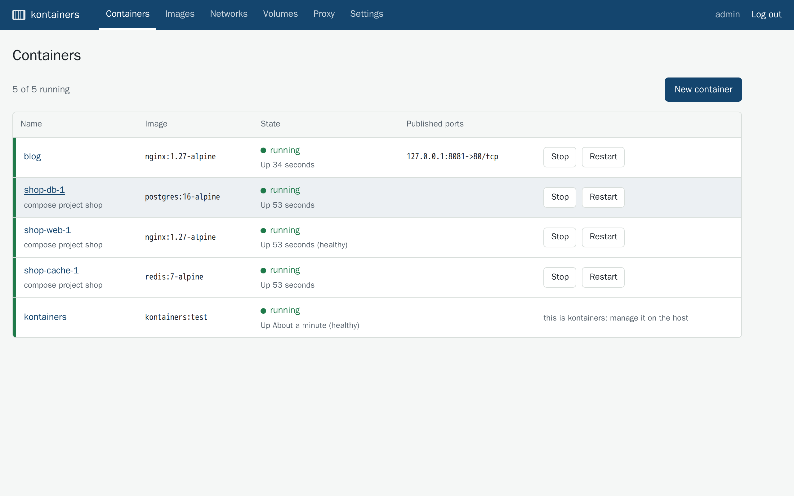
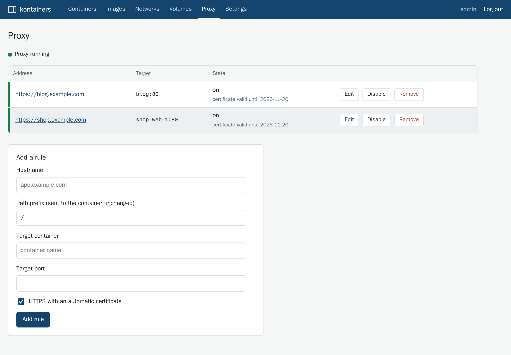

# kontainers

Manage the containers on one Docker host from a browser, and point a domain at any of them with an
HTTPS certificate it gets and renews for you. One container does both.

## Why it exists

If you run Portainer for your containers and Nginx Proxy Manager for your domains, kontainers is
one container that does the everyday part of both:

- Add a rule like `shop.example.com` to container `shop-web-1`, port 80, and the site is up over
  HTTPS. The Proxy page shows which certificates are valid and until when, and which rules point at
  a container that is stopped or gone.
- `docker compose up` recreates containers with new IDs. kontainers notices within 10 seconds and
  reconnects them, so the routes keep working.
- Update image pulls a container's image again and recreates it with the same settings. If the new
  one does not start, the old one is put back.

It is also careful about the host, because access to Docker is root on it. It listens on
127.0.0.1, has no default password, never force-removes a running container, and will not stop or
remove itself. The Security section below lists every default.

## What it costs to run

Memory and start time were measured on the 0.2.1 build, in Docker 29.8.2 on an arm64 host with
12 CPUs; the download size is the published 0.2.0 image's.

| | |
|---|---|
| Download | 82.5 MB (arm64) and 85.0 MB (amd64), compressed layers on Docker Hub |
| Memory at idle | 53 to 55 MiB, with Caddy serving two HTTPS rules and four other containers on the host (`docker stats` after 30 s, two runs) |
| Start | 1.0 to 4.2 s from `docker start` to a healthy `/healthz` (ten starts over two runs) |

`scripts/test.sh screenshots` repeats these measurements and regenerates the screenshots.

## Try it

    curl -O https://raw.githubusercontent.com/ao/kontainers/main/compose.yaml
    docker compose up -d
    docker compose logs kontainers | grep 'setup token'

Open http://127.0.0.1:8080, paste the token, and create your account. On a server, reach it over
SSH with `ssh -L 8080:127.0.0.1:8080 your-server`. To route domains, see
[Proxy rules and certificates](#proxy-rules-and-certificates).

## Status

Version 0.2 is a rewrite. Earlier releases (0.1.x) accepted any login and must not be used.

What works, and is covered by the test suites below:

- containers: list, inspect, create, start, stop, restart, unpause, remove (stopped containers
  only; kontainers never force-removes), logs. Commands are split with shell quoting
  (`sh -c "echo hi; sleep 60"`) but no shell runs and nothing is expanded. The detail page shows
  CPU, memory, network and process counts, refreshed every 5 seconds.
- update image, for containers created in kontainers: pull the image again and, if it changed,
  recreate the container with the same name, command, environment, ports, volumes, restart policy
  and networks. The old container is stopped and set aside first and is put back if the new one
  cannot be created or started. Compose containers are left to `docker compose pull && docker compose up -d`.
- images: list, pull (public images; registry logins are not supported), remove, per tag
- networks and volumes: list, create, remove
- proxy rules: hostname and path prefix to a container port, HTTPS with a certificate obtained
  automatically, or plain HTTP; edit, enable, disable, remove; kept across restarts
- local accounts, first-run setup, database backup

Not included: exec/terminal, compose stacks, multiple hosts, roles (every account is an
administrator), private registry logins.

## Security

Access to the Docker API is root on the host. Anyone who can log in to kontainers can start a
privileged container that mounts the host's filesystem, so treat every kontainers account as root.

What kontainers does about it:

- It listens on `127.0.0.1` by default. Outside a container it refuses to start on any other
  address over plain HTTP unless `KONTAINERS_PUBLIC_URL` is an `https://` URL or
  `KONTAINERS_ALLOW_INSECURE=1` is set. The image listens on all interfaces inside the container,
  so publish its port as `127.0.0.1:8080:8080`.
- There is no default password. On first start it prints a one-time setup token to its log; the
  first account is created with that token, and setup then closes.
- Sessions are server-side, in an `HttpOnly`, `SameSite=Strict` cookie (`Secure` and `__Host-`
  prefixed behind HTTPS), and expire after 12 hours idle or 7 days. Logging out, or changing a
  password, ends them. Passwords are hashed with argon2id.
- Every state change is a POST that needs a per-session CSRF token and a same-origin `Origin` /
  `Sec-Fetch-Site`. Requests with an unknown `Host` are refused, to stop DNS rebinding.
- Login is limited, per 15 minutes, to 5 failures per username and 20 per client address (the
  higher address limit is because everyone behind one SSH tunnel or proxy shares an address).
  Setup is limited to 5 wrong tokens per address.
  `X-Forwarded-For` is only read from addresses listed in `KONTAINERS_TRUSTED_PROXIES`.
- Container creation only sends image, name, command, environment, port bindings, named volumes
  and restart policy to Docker. Host paths as volumes are refused unless
  `KONTAINERS_ALLOW_BIND_MOUNTS=1`. Ports without a host address are published on `127.0.0.1`.
  There is no way to set privileged mode, capabilities, devices or host namespaces from the UI.
- The proxy configuration is generated from validated hostnames, path prefixes, container names
  and ports. Caddy's admin API is a unix socket in the data directory, not a TCP port.

Use `compose.yaml`, which gives kontainers the Docker API through
[docker-socket-proxy](https://github.com/Tecnativa/docker-socket-proxy) rather than the socket
itself. The proxy refuses build, swarm, plugin, secret and system endpoints, and refuses starting an
exec. It does not inspect request bodies, so it narrows what a compromised kontainers can reach
but does not stop it from creating a privileged container.

To reach kontainers from another machine, use an SSH tunnel:

    ssh -L 8080:127.0.0.1:8080 your-docker-host

or put it behind a reverse proxy that terminates HTTPS, and set `KONTAINERS_PUBLIC_URL`.

## Running

With compose (recommended):

    curl -O https://raw.githubusercontent.com/ao/kontainers/main/compose.yaml
    docker compose up -d
    docker compose logs kontainers | grep 'setup token'

Then open http://127.0.0.1:8080, enter the token, and create the first account.

With `docker run`, mounting the socket directly:

    docker run -d --name kontainers --restart unless-stopped \
      -p 127.0.0.1:8080:8080 \
      -v /var/run/docker.sock:/var/run/docker.sock \
      --group-add "$(stat -c %g /var/run/docker.sock)" \
      -v kontainers-data:/data \
      ataiva/kontainers:0.2.1
    docker logs kontainers | grep 'setup token'

The image runs as an unprivileged user, so it needs the socket's group (`--group-add`). On
Docker Desktop the socket is owned by root; use the compose file there.

## Proxy rules and certificates

Turn the proxy on with `KONTAINERS_PROXY=1` and publish ports 80 and 443. These two ports are meant
to be public: they serve the sites you route, not the kontainers UI.

    docker run -d --name kontainers --restart unless-stopped \
      -p 127.0.0.1:8080:8080 -p 80:80 -p 443:443 \
      -e KONTAINERS_PROXY=1 -e KONTAINERS_ACME_EMAIL=REPLACE-WITH-YOUR-EMAIL \
      -v /var/run/docker.sock:/var/run/docker.sock \
      --group-add "$(stat -c %g /var/run/docker.sock)" \
      -v kontainers-data:/data \
      ataiva/kontainers:0.2.1

Use your own email address: Let's Encrypt rejects reserved domains such as example.com, and
kontainers refuses to start with one.

Point the domain's DNS at the host, then add a rule on the Proxy page: hostname, optional path
prefix, target container name and port. kontainers connects the target container to the
`kontainers-proxy` network and Caddy reaches it by name; the target does not need to publish a
port. Every 10 seconds kontainers reconnects targets that left the network, which is what
`docker compose up` does when it recreates a container. The path prefix is matched but not
removed: a rule for `/api` sends `/api/users` to the container as `/api/users`. A wildcard
hostname (`*.example.com`) works over plain HTTP only: Let's Encrypt issues wildcard certificates
over a DNS challenge, which kontainers does not do, so add one HTTPS rule per name instead.

The Proxy page shows, for each rule, whether its target container exists and is running and,
for HTTPS rules, when its certificate expires or that there is none yet. A missing certificate
usually means DNS does not point at this host or ports 80 and 443 are not reachable; the
kontainers log has Caddy's error. With HTTPS on, Caddy obtains a certificate from Let's Encrypt over HTTP-01 or TLS-ALPN-01,
redirects HTTP to HTTPS, and renews the certificate before it expires: Caddy follows the renewal
window the CA suggests, or renews when a third of the lifetime is left. Certificates are stored in
the data volume. Adding the first HTTPS rule to a running kontainers restarts Caddy, which is
briefly unavailable; Caddy did not renew certificates in a process that started without HTTPS rules.

## Configuration

| Variable | Default | Meaning |
|---|---|---|
| `KONTAINERS_LISTEN` | `127.0.0.1:8080` (`0.0.0.0:8080` in the image) | Address for the UI |
| `KONTAINERS_PUBLIC_URL` | unset | Public `https://` URL when behind a TLS reverse proxy; enables `Secure` cookies and HSTS, and is the accepted `Host` |
| `KONTAINERS_TRUSTED_PROXIES` | unset | Comma-separated proxy addresses whose `X-Forwarded-For` is used for rate limiting |
| `KONTAINERS_ALLOW_INSECURE` | `0` | Allow a non-loopback listen address over plain HTTP |
| `KONTAINERS_DATA` | `./data` (`/data` in the image) | Database and certificates |
| `DOCKER_HOST` | `unix:///var/run/docker.sock` | `unix://`, `tcp://` or `http://` address of the Docker API |
| `KONTAINERS_ALLOW_BIND_MOUNTS` | `0` | Allow host paths as container volumes |
| `KONTAINERS_PROXY` | `0` | Run the proxy (Caddy) |
| `KONTAINERS_PROXY_NETWORK` | `kontainers-proxy` | Docker network shared by the proxy and its targets |
| `KONTAINERS_ACME_EMAIL` | unset | Contact address for the ACME account |
| `KONTAINERS_ACME_CA` | Let's Encrypt | ACME directory URL |
| `KONTAINERS_ACME_CA_ROOT` | unset | PEM file to trust for the ACME directory (for a private CA) |
| `KONTAINERS_ACME_RENEW_CHECK` | unset (Caddy's default) | Seconds between Caddy's checks for certificates due for renewal, 1 to 86400; HTTPS rules only |
| `KONTAINERS_SELF_CONTAINER` | the container's hostname | ID or name of kontainers' own container, if `--hostname` changed it; kontainers and its compose project get no Stop, Remove or Update |
| `KONTAINERS_HTTP_PORT` / `KONTAINERS_HTTPS_PORT` | `80` / `443` | Proxy ports |

`/healthz` returns 200 while the process runs. `/readyz` returns 200 when the database and the
Docker API are reachable, 503 otherwise. Neither needs a login.

## Backup and restore

The data volume holds `kontainers.db` (accounts, sessions, proxy rules) and `caddy/` (ACME account
and certificates). A consistent copy of the database, while kontainers runs:

    docker exec kontainers bun src/main.ts backup /data/backup.db
    docker cp kontainers:/data/backup.db .

or download one from Settings. To restore, stop kontainers, replace `kontainers.db` in the volume
with the backup (and delete any `kontainers.db-wal` and `kontainers.db-shm`), then start it.
Certificates that are not restored are obtained again.

Upgrades run database migrations at start. A database written by a newer version is refused
rather than modified.

## Development

All tests run in containers against a throwaway Docker-in-Docker daemon; nothing is published on
the host.

    scripts/test.sh            # all suites
    scripts/test.sh unit       # typecheck and unit tests
    scripts/test.sh api        # the server process against dind
    scripts/test.sh image      # the built image, behind docker-socket-proxy
    scripts/test.sh e2e        # Playwright (Chromium) against the image
    scripts/test.sh proxy      # proxy rules and certificates against Pebble, inside dind
    scripts/test.sh renewal    # Pebble issues 90-second certificates; Caddy must renew them itself

`KEEP=1` leaves the test environment running for inspection.

## Licence

MIT, see [LICENSE](LICENSE).
